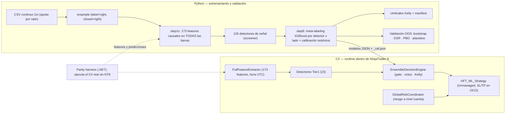

# 🤖 HFT_BOT_ML — Pipeline de ML Python ⇄ C# para NinjaTrader 8 (Showcase)

> [!IMPORTANT]
> **Proyecto personal (*side-project*) desarrollado en mi tiempo libre como ejercicio de Ingeniería de Software**: un pipeline de entrenamiento y validación en Python, y un runtime de inferencia en C# dentro de NinjaTrader 8 que debe comportarse igual que el pipeline. El dominio (micro-futuros) es el banco de pruebas; no busco un perfil de finanzas cuantitativas.
>
> **⚠️ No es un sistema rentable ni lo presento como tal.** La propia auditoría del proyecto ([`docs/AUDITORIA_2026-10.md`](docs/AUDITORIA_2026-10.md)) descubrió que la validación inicial tenía un *leak* de selección y que, con evaluación honesta, **no hay edge demostrado en ninguna de las 4 patas probadas**. La estrategia está limitada a cuentas Sim/Playback. Lo que sí documenta este repositorio es la ingeniería para detectarlo, medirlo y evitar que se repita.
>
> 🔒 El repositorio completo (**11 ficheros C# · 8.667 líneas, y 46 módulos Python · 23.693 líneas**) es privado. Aquí publico la arquitectura, la auditoría y **muestras reales de código en [`samples/`](samples/)**. Disponible para revisión de código en directo durante procesos de selección.

---

## 🏗️ Arquitectura

---

## 🧠 Historias de ingeniería (lo que realmente demuestra el proyecto)

### 1. Auditoría propia: detectar y corregir un *leak* de selección
* **Mecanismo:** el cache de features solo contenía las barras cuyas etiquetas *long y short* se resolvían en 5 barras: una condición sobre el **futuro** (~55 % de las barras). El resto se rellenaba con `NaN`, así que el meta-modelo aprendió «`NaN` = pérdida» y entre el 98 % y el 100 % de los trades «validados» caían en barras que ya se sabía que iban a resolverse.
* **Corrección:** cache con **todas** las barras, y guardas que **abortan** el entrenamiento y el backtest si la cobertura es inferior al 99 % (`--allow_partial_cache` existe solo para reproducir resultados antiguos).
* **Re-validación honesta:** misma lógica, mismos modelos, features en todas las barras: EV fuera de muestra ≈ 0 o negativa en las 8 mediciones (4 patas × 2 años). Tras reentrenar sin leak, ninguna pata se distingue del azar frente a placebos (DSR ≤ 0,25).
* 👉 Detalle completo, con tablas y commits: [`docs/AUDITORIA_2026-10.md`](docs/AUDITORIA_2026-10.md).

### 2. Paridad entre lenguajes: que el C# haga lo que valida el Python
* **Harness .NET** ([`samples/csharp/parity_harness/`](samples/csharp/parity_harness/)): compila el **código real del bot sin abrir NinjaTrader** y compara probabilidades y features contra Python.
* **Resultado medido:** predicciones idénticas en **54/54 modelos**; features idénticas **112/173** tras corregir la zona horaria, con las 61 restantes inventariadas como pendientes.
* **Divergencias encontradas y corregidas** (entre otras): `Time[0]` tratado como hora de Nueva York cuando NinjaTrader la entrega en la zona del equipo (features de sesión desplazadas ~6 h), ATR de Wilder frente a ATR por media simple, bloqueo de repetición de señales distinto por detector, y un `ForceClose` que **nunca** llegaba a dispararse con barras de 5/10/15 min.

### 3. Evaluador XGBoost en C# puro, sin dependencias
NinjaTrader 8 corre sobre .NET Framework 4.8 y no conviene arrastrar Newtonsoft ni runtimes de ML dentro del proceso. Por eso el proyecto incluye:
* [`HFT_BOT_ML_Common.cs`](samples/csharp/HFT_BOT_ML_Common.cs): lector de modelos XGBoost en JSON, con `base_score` convertido a *logit*, rama por defecto de los `NaN` por nodo (`default_left`), comparación en `float32` como XGBoost, validación estricta del número de features y **calibración isotónica** equivalente a `np.interp`.
* [`MiniJson.cs`](samples/csharp/MiniJson.cs): parser JSON recursivo propio, solo con `System.*`.

### 4. Diseño *fail-closed*
* `AllowRealAccount = false` por defecto: la estrategia solo envía órdenes en cuentas Sim/Playback.
* `RequireModels`: si el gráfico no tiene carpeta de modelos, la estrategia queda inerte.
* `deploy.sh` ejecuta antes de copiar nada la **paridad de predicciones** y una **compilación completa** del addon.
* [`GlobalRiskCoordinator.cs`](samples/csharp/GlobalRiskCoordinator.cs): estado de riesgo compartido entre instancias (posiciones por instancia, *halts* por drawdown y *profit lock*, bloqueo horario y cierre forzado).

### 5. Rigor estadístico y pre-registro
* [`stats_significance.py`](samples/python/stats_significance.py): bootstrap por bloques semanales, *Deflated Sharpe Ratio*, PBO e IC95 sobre los trades.
* **Placebos obligatorios** antes de creer una EV: entrar una barra tarde y sortear el lado.
* Paquete `research/` con **hipótesis pre-registradas** antes de ver retornos y [tests unitarios](samples/python/tests/test_research.py) de la contabilidad, la causalidad (sin información futura) y el calendario.

---

## 🧩 Muestras de código

Ver [`samples/README.md`](samples/README.md). Son ficheros reales extraídos sin modificar del repositorio privado. Dejo fuera los detectores de señal, los modelos y los datos.

## ⚠️ Aviso legal

Software con fines educativos y de investigación. Nada de lo aquí publicado constituye asesoramiento financiero ni una recomendación de inversión.

## 📄 Licencia

**GNU General Public License v3.0 (GPLv3)**. Consulta el archivo [`LICENSE`](LICENSE).
